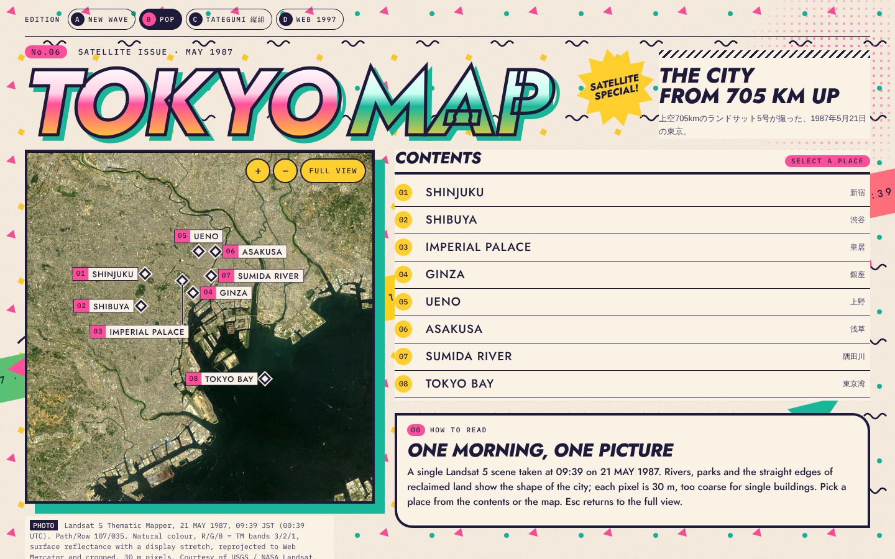
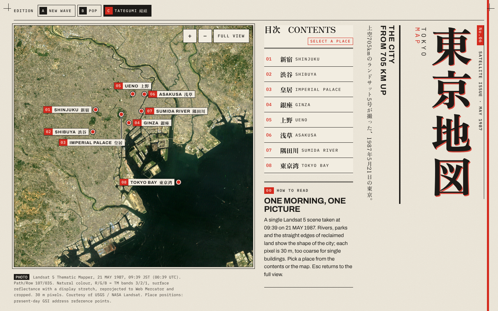
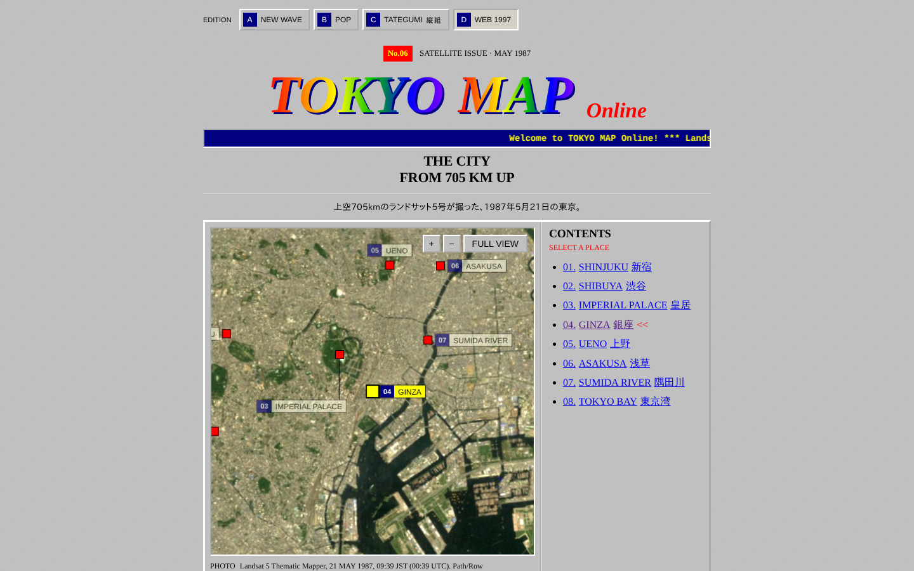
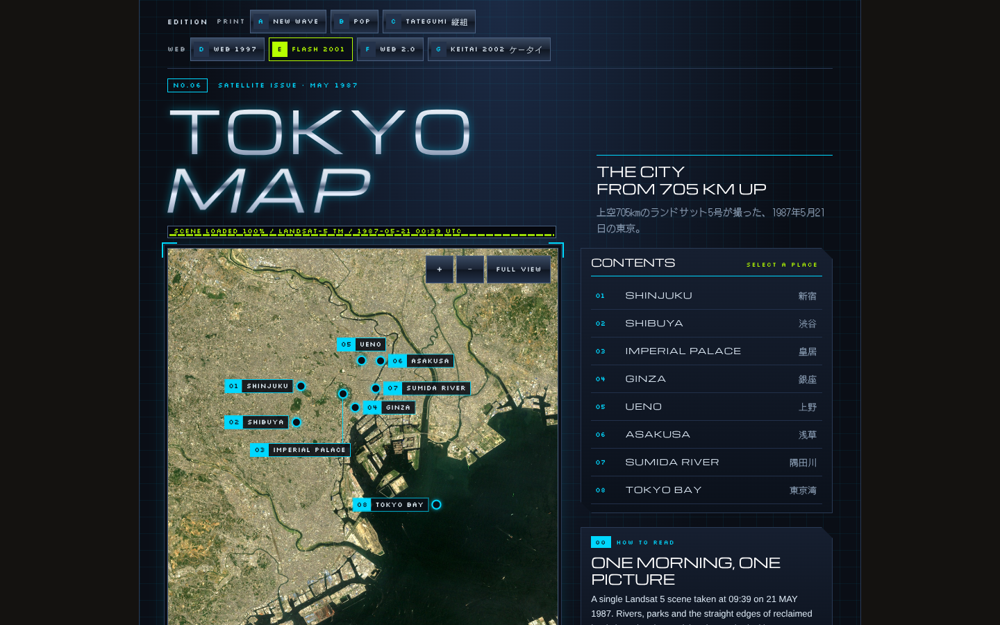
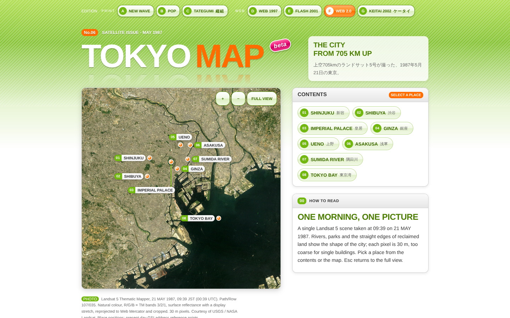
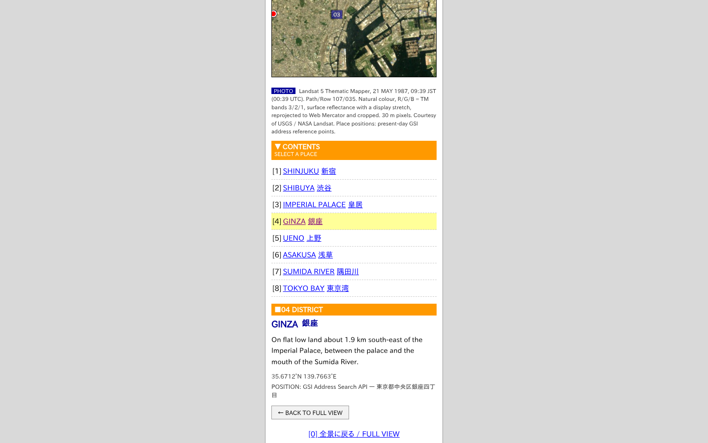
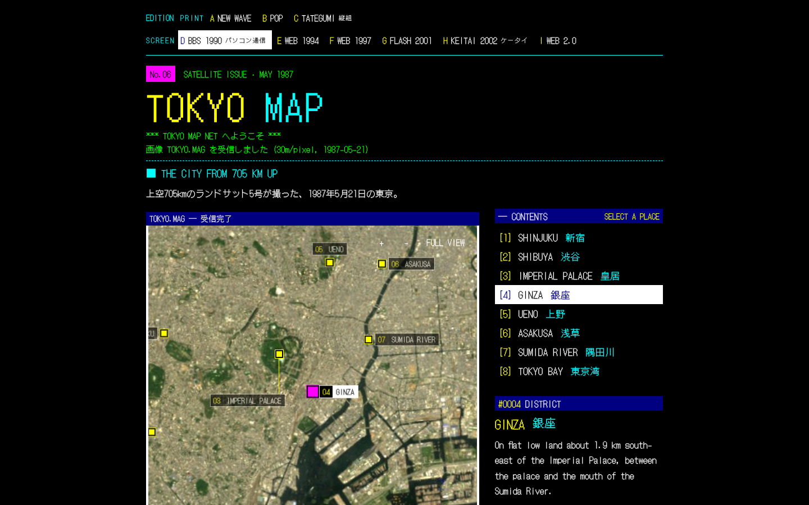
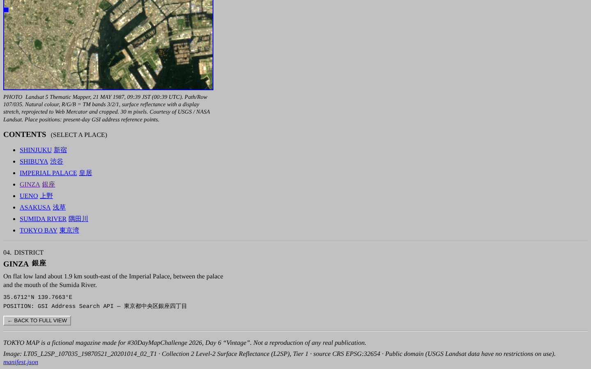
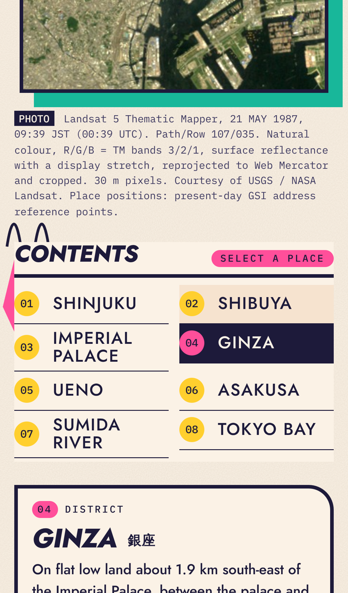
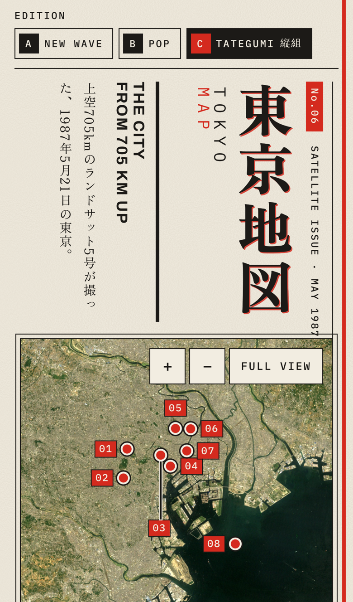

# TOKYO MAP — #30DayMapChallenge 2026 Day 6 “Vintage”

1980年代のニューウェーブ系カルチャー誌を手掛かりにした**架空の雑誌**の見開きとして、1987年5月21日のLandsat 5 TM画像で東京を眺めるWeb作品。実在誌の復刻・複製ではない。


## 9つのエディション

同じ衛星画像・地名データのまま、誌面デザインを9案から切り替えられる（画面上部の EDITION。紙の PRINT 3案と画面の SCREEN 6案。初期表示は F WEB 1997。`?ed=newwave|pop|tate|bbs|web94|web97|flash|keitai|web2` で直接指定でき、選択はブラウザに保存）。

| | 方向 | 書体・色 |
| - | - | - |
| A NEW WAVE | 硬派なニューウェーブ誌。極太グロテスク、斜めの帯、網点、トンボ、罫線 | Archivo Black / 墨・生成り・朱・コバルト |
| B POP | メンフィス調のポップ誌。グラデーション＋太い縁取りの誌名、星形シール、紙吹雪柄の地紙、エアブラシ風の帯 | Jost / 紺・クリーム・蛍光ピンク・ミント・黄 |
| C TATEGUMI 縦組 | 日本の情報誌。明朝の縦組み誌名「東京地図」、縦組みリード、網掛けの見出し、「保存版」の判、地名に漢字併記 | Zen Old Mincho / 墨・生成り・金赤 |
| D BBS 1990 パソコン通信 | パソコン通信の端末画面。黒地に16色のドット文字、反転表示のメニュー、受信した画像ファイル風の地図の枠、ステータス行。**数字キー1〜8で地名を選び、0で全景に戻る** | DotGothic16 |
| E WEB 1994 | 初期のグラフィカルブラウザで見る素のHTML。灰色の背景、既定の書体と見出し、溝付きの区切り線、リンク画像の青枠、黒丸の箇条書きリンク | Times New Roman（端末のフォント） |
| F WEB 1997 | 同じ雑誌が1990年代後半にWYSIWYGのページ作成ソフトで作った公式ホームページという設定。幅800pxの中央寄せ、パステル水色の背景、グラデーションと白フチのロゴ、ツヤのあるボタンのナビと左メニュー、グラデーションの見出し帯、流れる告知、更新履歴の NEW!、撮影日カウンター、工事中の帯 | Arial Black / MS Pゴシック（端末のフォント） |
| G FLASH 2001 | Flash全盛期のポータル風。暗い鋼色の地に方眼、クロームの誌名、ドット文字のキャプション、読み込みバー、計器風の四隅の括弧 | Michroma / Silkscreen / DotGothic16 / 黒紺・シアン・ライム |
| H KEITAI 2002 ケータイ | iモード風の幅360pxの1カラム。色帯の見出し、[1]〜[8]の番号付きリンク。**数字キー1〜8で地名を選び、0で全景に戻る**（D・H のみ） | MS Pゴシック（端末のフォント） |
| I WEB 2.0 | 2007年ごろのWeb 2.0風。黄緑のグラデーションとピンストライプ、床に映り込む誌名、beta バッジ、角丸の箱、ツヤのあるタグ状の目次 | Lucida Grande / Meiryo（端末のフォント） / 黄緑・オレンジ |

| B POP | C 縦組 | F WEB 1997（GINZA選択） |
| - | - | - |
|  |  |  |

| G FLASH 2001 | I WEB 2.0 | H ケータイ（GINZA選択） |
| - | - | - |
|  |  |  |

| D パソコン通信（GINZA選択） | E WEB 1994（GINZA選択） |
| - | - |
|  |  |

| スマホ A | スマホ B（GINZA選択） | スマホ C |
| - | - | - |
|  |  |  |

装飾はすべて地図の外側のレイヤで、地図画像・ラベル位置はエディションによらず共通。Webらしさ（流れる告知など）は各エディションの中だけに閉じ、他の誌面とは混ぜない。流れる告知は `prefers-reduced-motion` で止まる。

## 操作

- 目次（CONTENTS）または地図上の地名を選ぶと、その場所へ寄り、記事カードに短い説明を表示する。
- `FULL VIEW` / `BACK TO FULL VIEW` / `Esc` で全景へ戻る。`+` `−`、ドラッグ、ホイールで最小限のズーム・パン。
- 拡大は zoom 13 まで（30m画素を街区が読める解像度と見せないため）。
- `prefers-reduced-motion` 時は移動アニメーションなしで切り替える。

## 衛星画像

| 項目 | 値 |
| - | - |
| 製品ID | `LT05_L2SP_107035_19870521_20201014_02_T1` |
| 衛星・センサー | Landsat 5 / Thematic Mapper |
| 撮影日時 | 1987-05-21 00:39:47 UTC（09:39 JST） |
| WRS-2 Path/Row | 107 / 035 |
| 雲量 | シーン全体 0%（カタログ値）、表示範囲内 QA_PIXEL の雲・雲影フラグ 0.47% |
| 処理レベル | Collection 2 Level-2 地表面反射率（L2SP）, Tier 1 |
| 元CRS / 解像度 | EPSG:32654（UTM 54N）/ 30 m |
| 表示範囲 | 139.55–140.00°E, 35.45–35.82°N |
| RGB | R=SR_B3, G=SR_B2, B=SR_B1（自然色。近赤外は不使用） |
| 出典 | USGS / NASA Landsat。Public Domain（利用制限なし） |
| 取得経路 | Microsoft Planetary Computer の Landsat C2 L2 ミラー（USGS 製品と同一ファイル。USGS STAC へのリンクを manifest に記録） |

### 候補の比較

1984〜1989年・雲量10%未満で20シーンを検索し、6シーンを同じ範囲・同じ処理で目視比較した（`docs/candidates.png`）。

- 1985-01-07：表示範囲の南西（川崎沖）に雲と雲影があり除外。
- 1984-11-04 / 1987-07-24：全体に霞・暗い水面。
- 1988-12-01 / 1989-02-11（Landsat 4）：鮮明だが冬の褐色調で緑地が読みにくい。
- **1987-05-21を採用**：雲なし、公園・河川・埋立地の形が最も読みやすい。


### 加工内容

`scripts/build_rgb.py` が以下を行い、`public/data/tokyo-landsat.jpg` と `public/data/manifest.json` を出力する。

1. COGから表示範囲のウィンドウだけを読み込む（シーン全体はダウンロードしない）。
2. DN × 0.0000275 − 0.2 で地表面反射率に換算（DN=0 を nodata）。
3. 3バンド共通の線形ストレッチ（0.5–99.5パーセンタイル）＋ガンマ0.85。色は表示用のストレッチで、厳密な見たままの色ではない。
4. EPSG:32654 → EPSG:3857（MapLibreの表示CRS）へバイリニアで再投影し、範囲で切り出し。JPEG q90（1357×1373px）。
5. シーンID・撮影日時・雲量・処理内容・出典・取得日を manifest に記録。画面の日付・キャプションは manifest から供給（年号をハードコードしない）。

MapLibre の `image` ソースに manifest の4隅座標で配置する。

## 地名

`src/data/places.json`。地区・水域の**概略の代表点**であり、入口や行政界の重心ではない。位置は現在の住所参照点による。

| No | 名称 | 座標 | 位置の出典 |
| - | - | - | - |
| 01 | SHINJUKU 新宿 | 35.6912, 139.7036 | 国土地理院 アドレス検索API「新宿区新宿三丁目」 |
| 02 | SHIBUYA 渋谷 | 35.6573, 139.6983 | 同「渋谷区道玄坂一丁目」 |
| 03 | IMPERIAL PALACE 皇居 | 35.6841, 139.7522 | 同「千代田区千代田」 |
| 04 | GINZA 銀座 | 35.6712, 139.7663 | 同「中央区銀座四丁目」 |
| 05 | UENO 上野 | 35.7153, 139.7735 | 同「台東区上野公園」 |
| 06 | ASAKUSA 浅草 | 35.7149, 139.7955 | 同「台東区浅草二丁目」 |
| 07 | SUMIDA RIVER 隅田川 | 35.6891, 139.7899 | 本画像の河道上に配置（地理院地図で照合） |
| 08 | TOKYO BAY 東京湾 | 35.5800, 139.8600 | 本画像の水面上に配置（地理院地図で照合） |

説明文は位置と地形の理解に限定し、店舗・施設や当時の流行などの未検証情報は含めない。文中の距離は代表点間の大圏距離。

`npm run check:places` で、全地点が画像内にあること、水域ラベルが水面（暗い画素）上にあることを検査する。

## 実装

- Vite + React + TypeScript、MapLibre GL JS 5（ラスタ1枚の image ソース、APIキー・動的サーバー不要）。
- 地名ラベルは MapLibre Marker（HTML）で、地図の投影と同じ変換で配置。誌面装飾（斜めの帯・網点・紙の粒子・色版ずれ）は地図の外側の別レイヤ。地図本体には重ねない。
- 地名の操作は目次ボタン（キーボード・スクリーンリーダー対応、`aria-pressed`）が担い、地図上のラベルはその鏡像。
- 幅960px以下は縦組みに組み直し、地図の幅が480px未満では地図上は番号のみ（選択中のみ名称表示）。
- フォント：Archivo Black / Archivo / IBM Plex Mono / Jost / Zen Old Mincho / Michroma / Silkscreen / DotGothic16（いずれも SIL Open Font License、@fontsource で同梱）。E・F・H・I は当時の雰囲気を出すため端末のフォント（MS Pゴシック、Meiryo など）を優先し、無い環境では代替フォントで表示される。

## 再現手順

```bash
pip install rasterio numpy pillow
python3 -I scripts/build_rgb.py        # 画像と manifest を再生成
python3 -I scripts/check_places.py     # 地名位置の検査
npm ci
npm run build                          # dist/ に静的ビルド
```

候補比較画像は `python3 -I scripts/compare_candidates.py <STAC item id> ...` で `data/candidates/` に出力される。

## 公開

`main` への push で `.github/workflows/pages.yml` が GitHub Pages へデプロイする（リポジトリ設定 Pages → Source を「GitHub Actions」にする）。`vite.config.ts` は `base: './'` のため任意のサブパスで動作する。

## 検証

- 1440×900 と iPhone 13 相当（390×844）のヘッドレスChromiumで表示・選択・戻る操作を確認、コンソールエラーなし。
- 全ラベルの描画位置と `map.project(緯度経度)` の差が0.5px以内（全景・選択後とも）。
- 画像上で皇居・上野公園・新宿御苑・明治神宮の緑地、隅田川の河道と各ラベルの位置関係を目視確認。

## 残課題

- 実機（iOS Safari / Android Chrome）での確認は未実施。
- JSバンドルが約1.2MB（MapLibre込み、gzip 約350KB）。
